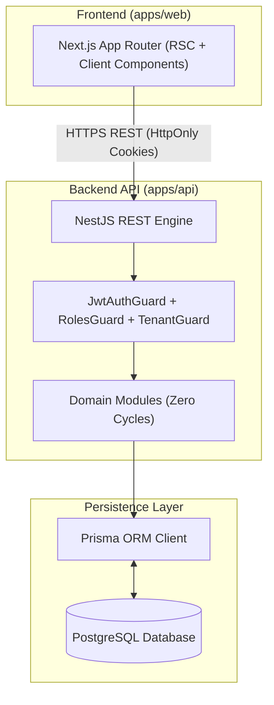

# EduVerse — Technical Architecture Specification

**Project:** EduVerse  
**Tagline:** *Learn Beyond Boundaries*  
**Architecture Lead:** Senior System Architect  
**Version:** 1.0.0  
**Status:** Approved  

---

## 1. System Overview

EduVerse is designed as a three-tier, modular monolith managed within a **pnpm monorepo**:
- **Client Tier (`apps/web`):** Next.js App Router (React 19, TypeScript, Tailwind CSS, shadcn/ui).
- **API Tier (`apps/api`):** NestJS REST API with modular architecture, strict DTO validation, and layered guards.
- **Persistence Tier:** PostgreSQL database with Prisma ORM client.
- **Shared Packages (`packages/*`):** Shared type definitions, Zod validation schemas, and a typed API client.



---

## 2. Monorepo Structure

```
eduverse/
├── apps/
│   ├── web/                     # Next.js App Router (Frontend)
│   └── api/                     # NestJS Core (Backend REST API)
├── packages/
│   ├── shared-types/            # Shared TypeScript interfaces & enums
│   ├── shared-validation/       # Shared Zod validation schemas
│   ├── api-client/              # Type-safe API client wrapper
│   ├── typescript-config/       # Shared tsconfig.base.json
│   └── eslint-config/           # Shared linting standards
├── infrastructure/              # docker-compose.yml for local PostgreSQL
├── docs/                        # SRS.md, DESIGN_SYSTEM.md, ARCHITECTURE.md, DATABASE.md, API.md
├── pnpm-workspace.yaml          # Workspace configuration
└── package.json                 # Monorepo scripts
```

---

## 3. Domain Modules & Separation of Concerns

1. **AuthModule:** User registration, credential verification (Argon2id), JWT access tokens (15m), and rotating refresh tokens (7d).
2. **UsersModule:** User profile queries, role assignments, password updates.
3. **InstitutionsModule:** Tenant creation, slug management, faculty invitation token generation.
4. **CoursesModule:** Course lifecycle state machine (`DRAFT`, `PUBLISHED`, `ARCHIVED`), categories, and ownership verification.
5. **LessonsModule:** Modules and Lessons hierarchy, rich text/markdown sanitization, video embed validation.
6. **EnrollmentsModule:** Student enrollments, duplicate checks, atomic lesson completion checkpoints, course progress percentage calculation.
7. **AssessmentsModule:** Quizzes, questions, multiple-choice options, automated scoring.
8. **AssignmentsModule:** Homework prompts, text/file submissions, instructor grading and feedback.
9. **CertificatesModule:** Atomic issuance upon verified 100% progress, UUID generation, public verification.
10. **NotificationsModule:** In-app system alerts dispatched via internal asynchronous event listeners.
11. **AnalyticsModule:** Read-only statistical aggregations for institutions and instructors.
12. **AdministrationModule:** Root platform audit logs, user suspension, and global catalog moderation.

---

## 4. Cross-Boundary Communication

To avoid circular dependencies between NestJS modules:
- Domain modules never import each other in circular loops.
- Asynchronous side effects (such as issuing a certificate and sending a notification when a student finishes the last lesson) are triggered via typed **NestJS EventEmitter** events:
  $$\text{EnrollmentService} \xrightarrow{\text{emit('course.completed')}} \begin{cases} \text{CertificatesConsumer} \\ \text{NotificationsConsumer} \end{cases}$$

---

## 5. Security & Invariant Enforcement

1. **Passwords:** Argon2id hashing with $64\text{ MB}$ memory cost, 3 iterations, 4 parallelism.
2. **Tokens:** JWT access tokens (15-minute lifetime) and refresh tokens stored hashed with automatic theft detection on reuse.
3. **Authorization:** Layered pipeline (`JwtAuthGuard` $\rightarrow$ `RolesGuard` $\rightarrow$ `TenantGuard` $\rightarrow$ Service-level ownership checks).
4. **Tenant Isolation:** Institutional queries must be scoped to `institutionId`. Cross-tenant mutations are rejected with `403 Forbidden`.

