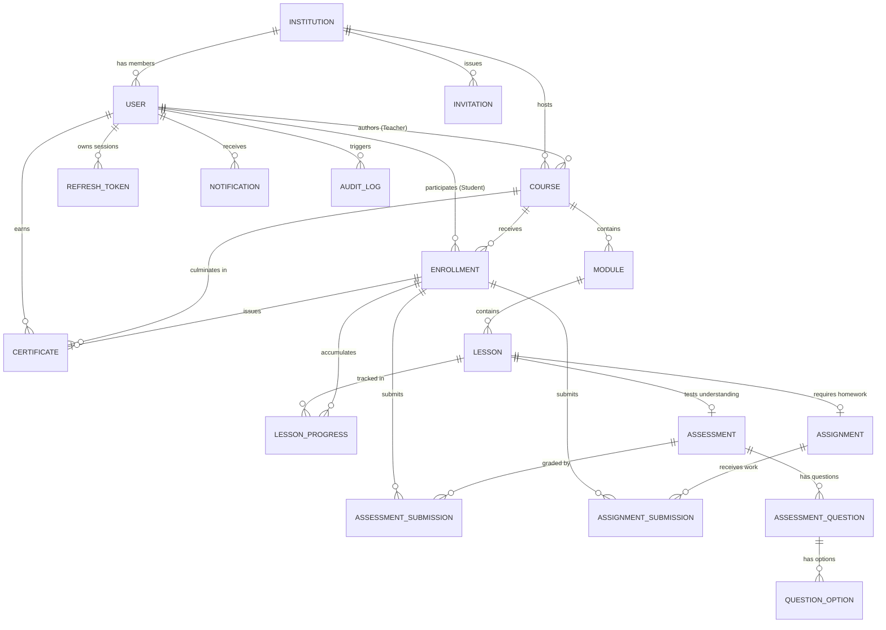

# EduVerse — Database Schema & Data Models

**Database Engine:** PostgreSQL 16+  
**ORM:** Prisma ORM  
**Version:** 1.0.0  
**Status:** Approved  

---

## 1. Entity-Relationship Overview

---

## 2. Table Specifications & Database Invariants

### 2.1 Table: `users`
| Column | Type | Constraints | Description |
| :--- | :--- | :--- | :--- |
| `id` | `UUID` | Primary Key, default `gen_random_uuid()` | Unique user identifier |
| `email` | `VARCHAR(255)` | Unique, Not Null | Unique academic/personal email |
| `passwordHash` | `TEXT` | Not Null | Argon2id hash |
| `fullName` | `VARCHAR(255)` | Not Null | Display name |
| `role` | `ENUM` | Default `'STUDENT'` | `SUPER_ADMIN`, `INSTITUTION_ADMIN`, `TEACHER`, `INDEPENDENT_INSTRUCTOR`, `STUDENT` |
| `institutionId` | `UUID` | Foreign Key `institutions.id`, Nullable | Affiliated institution (NULL for independent/public) |
| `isActive` | `BOOLEAN` | Default `true` | Account active state |
| `createdAt` | `TIMESTAMPTZ` | Default `NOW()` | Registration timestamp |
| `updatedAt` | `TIMESTAMPTZ` | Auto-update | Last modification timestamp |

### 2.2 Table: `institutions`
| Column | Type | Constraints | Description |
| :--- | :--- | :--- | :--- |
| `id` | `UUID` | Primary Key | Tenant identifier |
| `name` | `VARCHAR(255)` | Not Null | Institution legal or display name |
| `slug` | `VARCHAR(100)` | Unique, Not Null | URL slug (e.g. `aait`) |
| `domain` | `VARCHAR(255)` | Nullable | Allowed email domain for self-verification |
| `contactEmail` | `VARCHAR(255)` | Not Null | Administrative contact email |
| `isActive` | `BOOLEAN` | Default `true` | Tenant operational status |

### 2.3 Table: `courses`
| Column | Type | Constraints | Description |
| :--- | :--- | :--- | :--- |
| `id` | `UUID` | Primary Key | Course identifier |
| `title` | `VARCHAR(255)` | Not Null | Course title |
| `slug` | `VARCHAR(255)` | Unique, Not Null | URL friendly identifier |
| `description` | `TEXT` | Not Null | Overview summary |
| `category` | `VARCHAR(100)` | Not Null | Academic department/subject |
| `status` | `ENUM` | Default `'DRAFT'` | `'DRAFT'`, `'PUBLISHED'`, `'ARCHIVED'` |
| `authorId` | `UUID` | Foreign Key `users.id` | Teacher or instructor who created course |
| `institutionId` | `UUID` | Foreign Key `institutions.id`, Nullable | Institutional affiliation (NULL if independent) |

### 2.4 Table: `enrollments`
| Column | Type | Constraints | Description |
| :--- | :--- | :--- | :--- |
| `id` | `UUID` | Primary Key | Enrollment identifier |
| `userId` | `UUID` | Foreign Key `users.id` | Student |
| `courseId` | `UUID` | Foreign Key `courses.id` | Enrolled course |
| `progressPercentage` | `FLOAT` | Default `0.0` | Calculated completion ($0 - 100$) |
| `enrolledAt` | `TIMESTAMPTZ` | Default `NOW()` | Enrollment date |
| `completedAt` | `TIMESTAMPTZ` | Nullable | When progress reached 100% |

> **Constraint:** `UNIQUE (userId, courseId)` ensures a student cannot enroll twice in the same course.

### 2.5 Table: `lesson_progress`
| Column | Type | Constraints | Description |
| :--- | :--- | :--- | :--- |
| `id` | `UUID` | Primary Key | Progress record identifier |
| `enrollmentId` | `UUID` | Foreign Key `enrollments.id` | Parent enrollment |
| `lessonId` | `UUID` | Foreign Key `lessons.id` | Completed lesson |
| `completed` | `BOOLEAN` | Default `true` | Completion flag |
| `completedAt` | `TIMESTAMPTZ` | Default `NOW()` | Completion checkpoint timestamp |

> **Constraint:** `UNIQUE (enrollmentId, lessonId)` ensures idempotent progress recording.

### 2.6 Table: `certificates`
| Column | Type | Constraints | Description |
| :--- | :--- | :--- | :--- |
| `id` | `UUID` | Primary Key | Certificate identifier |
| `verificationCode` | `VARCHAR(64)` | Unique, Not Null | Cryptographic unguessable public lookup code |
| `enrollmentId` | `UUID` | Foreign Key `enrollments.id`, Unique | 1:1 link to verified enrollment |
| `userId` | `UUID` | Foreign Key `users.id` | Recipient student |
| `courseId` | `UUID` | Foreign Key `courses.id` | Completed course |
| `issuedAt` | `TIMESTAMPTZ` | Default `NOW()` | Timestamp of 100% progress verification |

