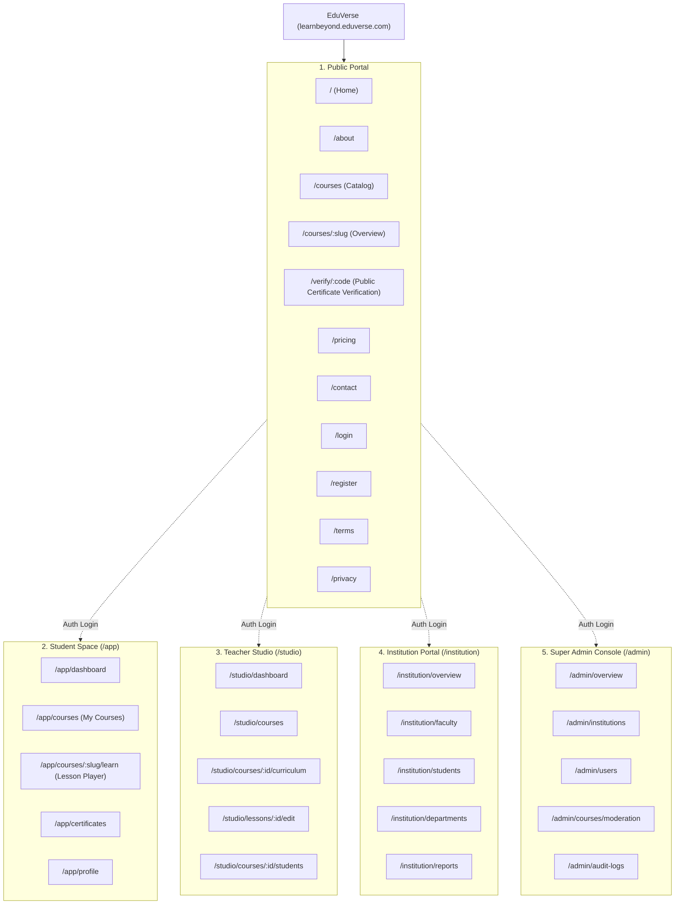
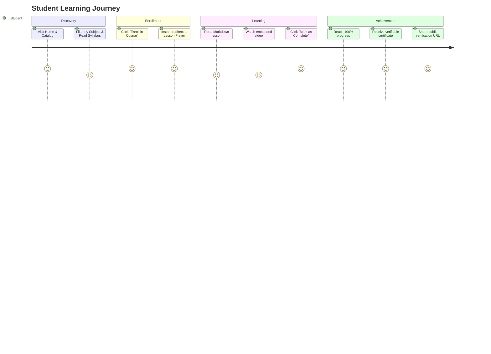

# EduVerse — UI/UX Design System & Experience Specifications

**Project Name:** EduVerse  
**Tagline:** *Learn Beyond Boundaries*  
**Document Status:** Pending Review & Approval  
**Design Phase:** Phase 1 (UI/UX Engineering & Design System)  

---

## 1. Brand Guide

### 1.1 Brand Identity & Values
- **Brand Purpose:** Democratize structured higher and vocational education with reliable, low-bandwidth, and verifiable learning workflows.
- **Brand Personality:** Academic, trustworthy, modern, disciplined, uncluttered.
- **Visual Tenets:**
  1. *Substance over Flash:* No gratuitous 3D blobs, neon glows, or distracting layout shifts.
  2. *Data Efficiency:* Layouts must render instantly on mobile 3G networks.
  3. *Uncompromising Contrast:* High legibility for prolonged study sessions on low-cost displays.

### 1.2 Color Palette & Semantic Tokens

| Token Name | Hex Value | Semantic Role | Contrast Ratio against White |
| :--- | :--- | :--- | :--- |
| **Primary Navy** | `#14213D` | Primary headers, brand elements, active states | **14.2:1** (WCAG AAA) |
| **Emerald** | `#168B79` | Primary CTA, completions, success badges | **4.6:1** (WCAG AA) |
| **Soft Mint** | `#E9F7F2` | Background surface tint for cards and chips | N/A (Surface background) |
| **Page Background**| `#FAFBFC` | Main canvas background, light neutral | N/A (Canvas background) |
| **Accent Amber** | `#F4B942` | In-progress indicators, warning chips, focus rings | **3.2:1** (Large text/graphical elements) |
| **Slate Gray** | `#64748B` | Secondary copy, metadata, subtle borders | **4.7:1** (WCAG AA for body text) |
| **Border Gray** | `#E2E8F0` | Structural dividers, card borders | N/A (Structural boundary) |

### 1.3 Typography Scale
- **Font Stack:** Clean system sans-serif: `Inter`, `-apple-system`, `BlinkMacSystemFont`, `"Segoe UI"`, `Roboto`, `sans-serif`.
- **Monospace Stack:** `JetBrains Mono`, `Fira Code`, `ui-monospace`, `monospace` (for code lessons, terminal output, and certificate verification hashes).

| Style | Size | Weight | Line Height | Usage |
| :--- | :--- | :--- | :--- | :--- |
| **Display 1** | $32\text{ px}$ (`2rem`) | Bold (700) | $1.25$ | Hero headlines |
| **Heading 1** | $24\text{ px}$ (`1.5rem`) | Bold (700) | $1.3$ | Page titles, major dashboard headers |
| **Heading 2** | $18\text{ px}$ (`1.125rem`)| Semi-bold (600) | $1.35$ | Module titles, section headers |
| **Heading 3** | $15\text{ px}$ (`0.9375rem`)| Semi-bold (600) | $1.4$ | Card headings, lesson titles |
| **Body Regular**| $14\text{ px}$ (`0.875rem`)| Regular (400) | $1.5$ | Lesson reading prose, general copy |
| **Body Small** | $12\text{ px}$ (`0.75rem`) | Medium (500) | $1.4$ | Table rows, input field labels, helper text |
| **Caption/Chip**| $11\text{ px}$ (`0.6875rem`)| Semi-bold (600) | $1.3$ | Badges, status chips, metadata timestamps |

---

## 2. Sitemap



---

## 3. Navigation Structure & Shell Layouts

### 3.1 Public Navigation
- **Header:** Sticky, backdrop blur, clean border.
  - Left: EduVerse brand mark + Primary nav items (`Courses`, `Institutions`, `Verify Certificate`, `About`).
  - Right: `Sign In` text button + `Get Started` filled emerald button.
- **Footer:** 4-column layout (`Product`, `Institutions`, `Legal`, `Support`).

### 3.2 Authenticated Unified Shell (Student, Teacher, Admin)
- **Top Bar ($56\text{ px}$ height):**
  - Left: Hamburger toggle (mobile) + Workspace context switcher.
  - Center: Contextual title / breadcrumbs.
  - Right: User avatar with role chip + dropdown menu (`Profile`, `Settings`, `Sign Out`).
- **Collapsible Sidebar ($240\text{ px}$ desktop / overlay drawer on mobile):**
  - Nav items with distinct outline icons, active state highlighted in Soft Mint (`#E9F7F2`) with Emerald indicator (`#168B79`).

---

## 4. User Journey Diagrams

### 4.1 Student: Browse $\rightarrow$ Enroll $\rightarrow$ Complete $\rightarrow$ Certify



---

## 5. Low-Fidelity Wireframes

### 5.1 Public Course Marketplace Wireframe

```
+-------------------------------------------------------------------------------+
| [EV] EduVerse      Courses   Institutions   Verify Cert           [Sign In] [Start] |
+-------------------------------------------------------------------------------+
|                                                                               |
|                   LEARN BEYOND BOUNDARIES                                     |
|     High-performance, accessible learning for ambitious students.             |
|                                                                               |
|     [ Search by topic, instructor, or university...                 ] [Search] |
|                                                                               |
+-------------------------------------------------------------------------------+
| Featured Curricula                                            Filter: [All v] |
|                                                                               |
| +-------------------------+ +-------------------------+ +-------------------+ |
| | [Category Tag]  8 Mods  | | [Category Tag]  12 Mods | | [Category] 6 Mods | |
| | Data Structures in TS   | | Full-Stack Architectures| | Applied Statistics| |
| | Low-bandwidth guides... | | Relational schemas...   | | Real-world data...| |
| | ----------------------- | | ----------------------- | | ----------------- | |
| | (o) Instructor Name     | | (o) Instructor Name     | | (o) Inst. Name    | |
| | Free          [Enroll]  | | Free          [Enroll]  | | Free     [Enroll] | |
| +-------------------------+ +-------------------------+ +-------------------+ |
+-------------------------------------------------------------------------------+
```

### 5.2 Student Course Player Wireframe

```
+-------------------------------------------------------------------------------+
| [<- Back to Dashboard]  Data Structures in TS        Progress: [=====>   ] 60%|
+------------------------------------+------------------------------------------+
| CURRICULUM SYLLABUS                | LESSON CONTENT (Module 2 • Lesson 2.2)   |
|                                    |                                          |
| v Module 1: Complexity (2/2) [v]   | # Singly vs Doubly Linked Lists          |
|   [v] 1.1 Big-O Notation           |                                          |
|   [v] 1.2 Space Complexity         | In this lesson, we examine node pointers |
|                                    | and memory allocation patterns...        |
| v Module 2: Linear Types (1/3)     |                                          |
|   [v] 2.1 Dynamic Arrays           | ```typescript                            |
|   [*] 2.2 Linked Lists (Active)    | export class ListNode<T> { ... }         |
|   [ ] 2.3 Stacks & Queues          | ```                                      |
|                                    |                                          |
| > Module 3: Trees & Graphs [Lock]  |                                          |
|                                    | ---------------------------------------- |
|                                    | [<- Previous]   [Mark Complete v] [Next] |
+------------------------------------+------------------------------------------+
```

---

## 6. High-Fidelity Screen Specifications

### 6.1 Public Website Pages
1. **Home (`/`):** Hero section with tagline, featured course carousel, institutional proof metrics, and "How It Works" 3-step value illustration.
2. **Catalog (`/courses`):** Faceted search (Department, Subject, Level, Institution), sort by date/popularity, responsive card grid.
3. **Course Details (`/courses/:slug`):** Syllabus accordion, instructor credentials, estimated duration, prerequisites, single-click enrollment button.
4. **Certificate Verification (`/verify/:code`):** Clean single-card verification view showing recipient name, course title, issuance date, issuer signature hash, and a "Verified Authentic" emerald seal.
5. **Authentication (`/login`, `/register`):** Distraction-free centered card layout, explicit password requirements checklist, error alert container.

### 6.2 Student Experience Pages
1. **Student Dashboard (`/app/dashboard`):** Active courses in progress, completion percentages, quick resume button ("Continue Lesson 2.2"), recent certificates earned.
2. **Course Player (`/app/courses/:slug/learn`):** Two-pane layout: collapsible syllabus left-pane + clean distraction-free reader right-pane with markdown rendering and embedded video player.
3. **Certificates (`/app/certificates`):** Gallery of earned credentials with copyable public verification links and download options.

### 6.3 Teacher Studio Pages
1. **Studio Dashboard (`/studio/dashboard`):** Active published courses, draft courses, total enrolled students, recent completion milestones.
2. **Curriculum Builder (`/studio/courses/:id/curriculum`):** Drag-and-drop module and lesson ordering, inline lesson creation modal, publish status toggle (`DRAFT` vs `PUBLISHED`).
3. **Lesson Editor (`/studio/lessons/:id/edit`):** Split-view or tabbed Markdown editor with live preview, video embed URL validator, duration calculator.
4. **Student Roster (`/studio/courses/:id/students`):** Student table with enrollment dates, completed lesson counters, and progress progress-bars.

### 6.4 Institution Admin Pages
1. **Institution Overview (`/institution/overview`):** Aggregate faculty count, course count, enrolled student metrics, department distribution.
2. **Faculty Management (`/institution/faculty`):** Email invitation modal, single-use token generator, active faculty table with assigned course counters and revoke access controls.
3. **Departments (`/institution/departments`):** Department organizational tree (e.g., Computer Science, Electrical Engineering, Medicine).

### 6.5 Super Admin Pages
1. **Platform Overview (`/admin/overview`):** Total multi-tenant organizations, active users by role, server health, system-wide course statistics.
2. **Tenant Provisioning (`/admin/institutions`):** Organization creation drawer (name, slug, admin email, allowed domains).
3. **User Governance (`/admin/users`):** Global user search, role escalation override, account suspension toggle.
4. **Security & Audit Logs (`/admin/audit-logs`):** Token rotation events, failed login alerts, certificate issuance records with IP and timestamp logs.

---

## 7. Responsive Mobile-Browser Layouts

To cater to Ethiopian mobile network users browsing on Android devices:
- **Mobile Breakpoint:** $< 768\text{ px}$ (`sm`/`md` boundary).
- **Curriculum Navigation:** In the Course Player, the left syllabus pane collapses into an off-canvas slide-over drawer toggled via a sticky bottom bar (`"Syllabus (60%)"`).
- **Sticky Actions:** The `"Mark as Complete"` button pins to the bottom of the mobile viewport with safe-area padding so students can easily tap with one thumb.
- **Horizontal Scrolling Tables:** Data tables on admin dashboards wrap in smooth horizontal scroll containers (`overflow-x-auto`) with fixed first-column names to prevent layout breaking.

---

## 8. Reusable Component Inventory (shadcn/ui compatible)

1. **Buttons:** `Primary` (Navy), `Success` (Emerald), `Outline` (Slate-bordered), `Ghost`, `Destructive` (Rose), `Disabled`.
2. **Inputs & Form Controls:** `TextField`, `PasswordInput` (with visibility toggle), `Textarea` (Markdown), `Select`, `Checkbox`, `Switch`.
3. **Badges & Chips:** `StatusChip` (`Draft`, `Published`, `Archived`), `RoleChip` (`Student`, `Teacher`, `Admin`), `ProgressChip`.
4. **Cards & Containers:** `CourseCard`, `ModuleContainer`, `MetricStatCard`, `EmptyStateContainer`.
5. **Modals & Drawers:** `ConfirmationDialog`, `InviteTeacherModal`, `CourseCreationDrawer`.
6. **Progress Indicators:** `LinearProgressBar`, `CompletionCheckmark`, `CircularProgressBadge`.

---

## 9. State Specifications: Loading, Empty, Success & Error

| State | Visual Treatment | Example Scenario |
| :--- | :--- | :--- |
| **Loading** | Clean pulse skeleton bars with exact component dimensions; no spinning full-page overlays. | Course catalog fetching lessons over a 3G connection. |
| **Empty** | Dashed border container, neutral icon, informative heading, and a direct primary CTA button. | Student dashboard when not enrolled in any course: *"No courses yet. [Browse Catalog]"*. |
| **Success** | Emerald toast / inline banner with green border (`#168B79`) and clear confirmation copy. | Lesson completed; Certificate generated with link. |
| **Error** | Rose tinted card/toast (`#FEE2E2` / `#991B1B`) with field-specific guidance; never exposes stack traces. | Incomplete form validation or expired refresh token. |

---

## 10. Accessibility & Standards (WCAG 2.1 AA)

1. **Color Contrast:**
   - Body copy (`#14213D` on `#FAFBFC`) = $14.2:1$ (exceeds $4.5:1$ AA standard).
   - Secondary copy (`#64748B` on `#FAFBFC`) = $4.7:1$ (exceeds $4.5:1$ AA standard).
   - Primary action buttons (`#168B79` with white text) = $4.6:1$.
2. **Keyboard Navigation:** Every interactive button, link, and form input features an explicit `focus-visible:ring-2 focus:ring-[#168B79]` focus outline.
3. **Screen Readers:** All icon-only buttons include descriptive `aria-label` attributes (e.g., `aria-label="Toggle curriculum sidebar"`).
4. **Touch Targets:** All clickable mobile elements maintain a minimum target size of $44\text{ px} \times 44\text{ px}$.

